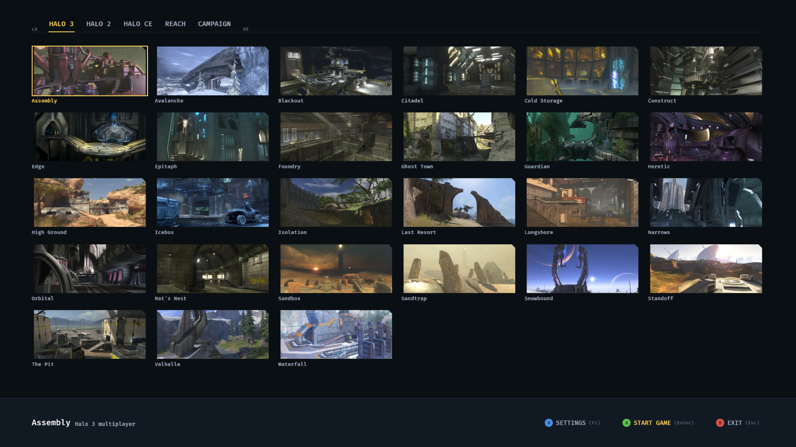
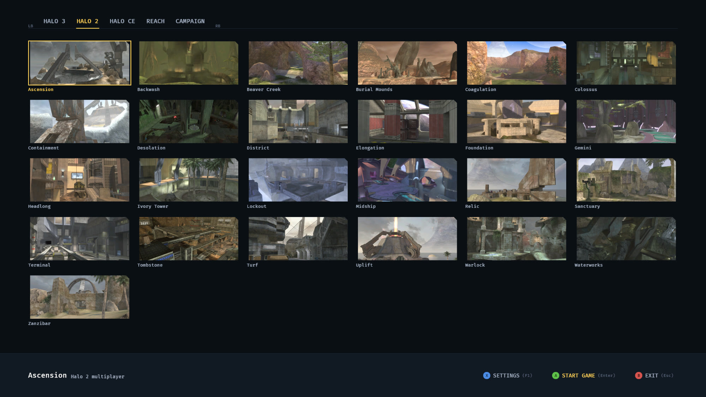
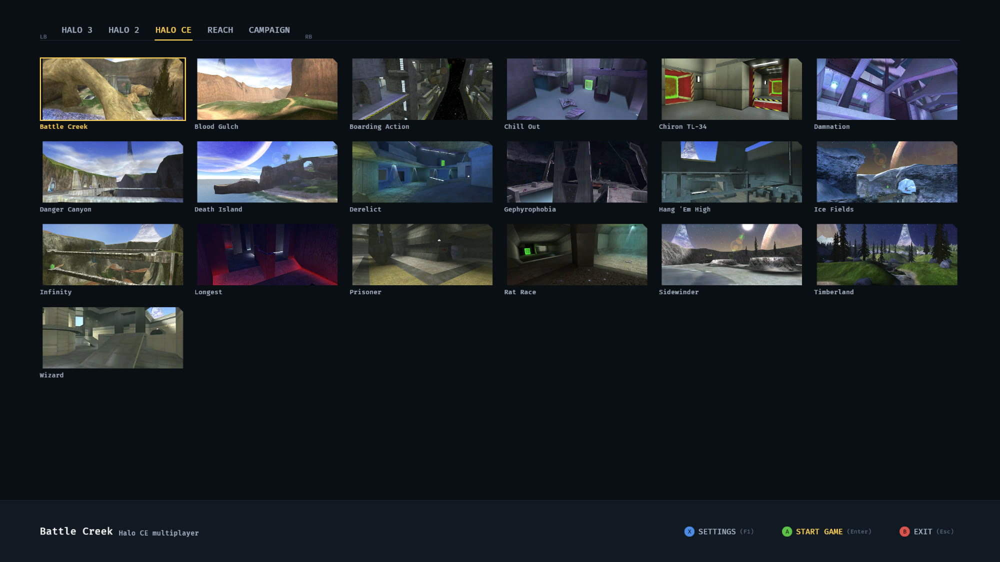
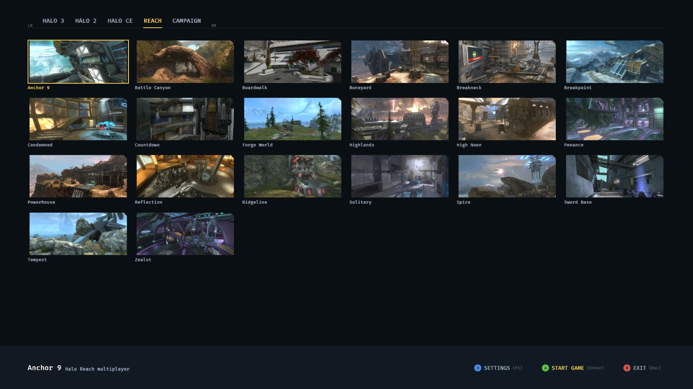
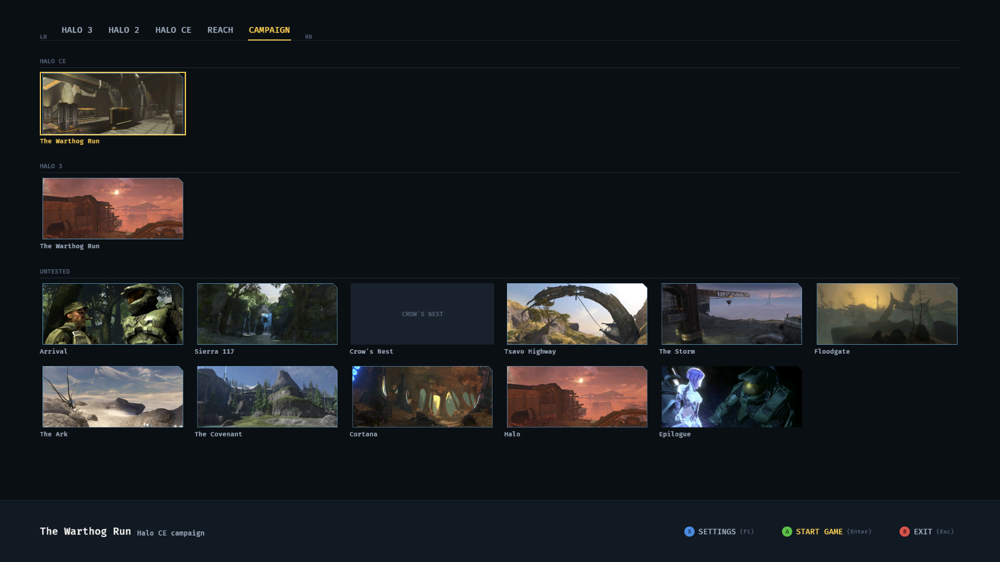

# Halo MCC in Rust

**My main goal with this was to be able to skate and also ride a dirt bike on Halo multiplayer maps.**

A from-scratch Rust runtime for the Halo games of the Master Chief Collection,
reading the map files of the player's own MCC install: Halo 3 first (multiplayer
maps and the final mission, `120_halo`), and Halo 2, Halo CE and Reach maps
too. Built the way IW4L rebuilt Modern Warfare 2: own readers for the game's
files, own renderer on bevy and wgpu.

On those maps you can:

- **skate**, when the player has Skate 3, with Skate 3's own physics (the Skate 3 engine in
  `third_party/skate-engine`, fed from the player's own copy of Skate 3). The skating
  comes from chasm's [2010 Rust Rewrite Mashup](https://github.com/chasmlol/2010-rust-rewrite-mashup)
  (MW2 Skate 3), which built it on the
  [Skate 3 Rust Engine](https://github.com/SK8-ENGINE/skate-3-rust-engine);
- **ride a dirt bike**, with MX vs ATV Reflex's own bike simulation and, when
  the player has Reflex, its Dakumoto 450F model and engine sound (our own
  stand-in bike without it);
- **walk** as the Spartan with the map's weapons, or fly around (noclip).

It's main focus is on multiplayer maps in MCC but I did work on converting the two warthog runs from H3 and H1. H3 warthog run is very fun. There are other campaign maps but they are mostly untested and missing most things like scripting and enemies.

## Screenshots

The map select menu, one tab per game (LB/RB to switch). The pictures are
read from the player's own MCC install.











The exe is `mcc-rust-rewrite.exe`.

`HANDOFF.md` has the goals, the research and the open decisions. `docs/` holds
the format descriptions the code is written from.

## Rules

- No game files live here. The code reads the MCC install read-only.
- Nothing here launches the game.
- The format descriptions in `docs/format` were written by reading the files
  on disk and public format documentation. No code from other Halo tools is
  copied (Reclaimer, TagTool, Assembly). The one outside code base in the
  tree is the Skate 3 engine in `third_party/skate-engine` (see Licence).

## Layout

| path | what |
|---|---|
| `crates/blam_anim` | Halo 3 animation graphs (`jmad`): skeleton, animation list, the mode / weapon class / weapon type / action tree, every codec of the animation data; poses sampled, blended and turned into skinning matrices (`docs/format/animation.md`) |
| `crates/blam_cache` | opens a `.map`: header, sections, tag index, tag names, string ids, a cursor for tag data, resource pages |
| `crates/blam_geometry` | decodes structure BSPs (clusters and instances) into plain meshes with materials |
| `crates/blam_h1` | MCC Halo CE maps: tags, BSP lightmap meshes, collision, gbxmodels, shaders, bitmaps (`bitmaps.map`), spawns and sky decoded into the same `Scene` (`docs/format/halo1.md`) |
| `crates/blam_h2` | MCC Halo 2 maps: inflated in memory, tags, `shared.map` and `textures.dat` read, BSP, collision, objects, spawns, shaders and bitmaps decoded into the same `Scene` (`docs/format/halo2.md`) |
| `crates/blam_script` | reads the HaloScript compiled into a scenario (scripts, globals, the expression table, the names scripts use) and prints it as source (`docs/format/halo-script.md`) |
| `crates/blam_sound` | Halo 3's sound: `snd!` / `lsnd` / sound scenery / BSP acoustics tags, and MCC's FMOD bank (FSB5 Vorbis) they play from, decoded with lewton |
| `crates/blam_effect` | Halo 3's effects: `effe` events and parts, particle systems and emitters with their function blobs, particles (`prt3`) with their render method, particle physics (`pmov`), contrails (`cntl`), lights (`ligh`) (`docs/format/effects.md`) |
| `crates/blam_texture` | decodes bitmap tags into mip chains (BCn kept as blocks) and resolves shader tags to their textures, tiling and blend options |
| `crates/blam_cli` | the `blam` tool: list tags, classes and strings, dump tag bytes, decode geometry to OBJ, inspect bitmaps and shaders, write PNGs |
| `crates/blam_reach` | MCC Halo: Reach maps: BSPs from the lightmap BSP data, instances from their resource, collision, objects, sky, spawns and lightmap texcoords into the same `Scene`; the cache file, shaders and bitmaps go through `blam_cache` / `blam_texture`, which tell Reach by its header (`docs/format/reach.md`) |
| `crates/fsb_celt` | decodes FMOD's FSB5 CELT samples (MCC Halo CE's sound banks) with the vendored CELT 0.11.0 decoder |
| `crates/game_paths` | where the player's games are: the saved setup and dev overrides (`HALO3_MAPS`, ...); nothing is searched for. No dependencies; the readers' tests use it |
| `crates/mcc_setup` | first-run setup: find MCC, take Skate 3 (`.iso` or `default.xex`, converted once) and Reflex if the player has them, save the answers (a skipped game too) |
| `crates/mcc-rust-rewrite` | the `mcc-rust-rewrite` binary: the map menu (`menu.rs`), wires the crates below into an app, `--shot` screenshots, the pause menu, Halo 2 maps into the viewer's looks (`docs/viewer.md`) |
| `crates/mcc_core` | what the runtime crates share: the map phase (`map.rs`: a map loaded, started and unloaded inside the running app), coordinate frames, the pause flag, the flying camera, zone-set state, the rider's pose, kill zones, weapon messages. Every `mcc_*` crate depends on it, so keep it small |
| `crates/mcc_textures` | resolves a scene's materials to decoded textures and lightmaps (no bevy) |
| `crates/mcc_world` | the world on the GPU: BSP streaming, culling, lightmaps, sky, water, zone keys |
| `crates/mcc_anim` | Halo's own animations on objects: `AnimModel` (one per object type) and the `Animator` component (actions with fallbacks, cross-fades, overlays, aiming, device positions, root motion) posing skinned joints |
| `crates/mcc_audio` | the map's sounds, music, the board sounds and the weapons' sounds |
| `crates/mcc_skate` | skating through the Skate 3 engine (`skate-host`) |
| `third_party/skate-engine` | the Skate 3 engine crates, vendored (GPL-3.0; its README says where from and what we changed) |
| `third_party/celt-0.11.0` | Xiph's CELT 0.11.0 decoder in C (BSD-3-Clause), built by `fsb_celt` |
| `third_party/reflex-physics` | MX vs ATV Reflex's bike simulation (`reflex_core`, `reflex_bevy`), vendored from the user's `reflex-physics` workspace (its README says what we changed) |
| `crates/mcc_rider` | the Spartan on the board, and the skeleton he is posed on: Skate 3's skater, or without Skate 3 Master Chief's own (`halo_rig.rs`, `docs/rider.md`) |
| `crates/mcc_bike` | the dirt bike (Reflex's own simulation from `third_party/reflex-physics`, or MX vs ATV Unleashed's model with Reflex's numbers), drawn as Reflex's Dakumoto 450F in the Cortana kit |
| `crates/reflex_assets` | reads the user's MX vs ATV Reflex install (database/package pairs, LZX, meshes, skeletons, textures) for the bike model, and imports what the bike needs once at setup (no bevy) |
| `crates/mcc_foot` | the Spartan on foot |
| `crates/mcc_script` | runs a map's own scripts: threads at 30 ticks a second, objects created, destroyed, dropped and moved, devices, trigger volumes, insertion points; hooks for the AI and device animation |
| `crates/mcc_effects` | plays the effects the scripts and damaged objects ask for from the map's `effe` tags: particles, contrails, light flashes, sounds |
| `crates/mcc_weapons` | the map's weapons, carried and fired on foot; rounds hit actors and the player |
| `crates/mcc_ai` | the campaign's squads as actors: placed, drawn, hurt and fighting; the player's shields and health |
| `crates/mcc_swim` | water, sinking and splashes |
| `docs/format` | the file format, field by field |
| `docs/` | notes on IW4L and the skate interface |

## First run

Nothing from any of the three games ships with this project. The first time `mcc-rust-rewrite` opens a
window it opens on its setup screen (`crates/mcc-rust-rewrite/src/menu/setup.rs`, in the map menu's own
look) and asks for the player's own copies, once, one step per game: each row's Select opens a
Windows folder picker, and problems are shown on the screen. Nothing is searched for; the
game uses only the folders the player chooses. Only MCC is required: the game stays on the
setup screen until MCC is set up and Skate 3 and Reflex are each set up or skipped (B /
Escape on the first step closes it). Skate 3 and Reflex are optional (Skip), and either can
be added later in Settings. A map named on the command line before setup is done waits for
the next launch.

1. **Halo: The Master Chief Collection.** The MCC folder (or its `halo3` / `halo3\maps`
   folder); the Halo 3 build is checked.
2. **Skate 3 for Xbox 360** (optional; the skateboard and grind rails). The folder of the
   extracted game (`default.xex` with its `data`
   folder, directly inside or one folder down) or the folder holding its disc image (`.iso`,
   the only one there). From an image only
   what the converter reads is copied out (`default.xex`, four `.big` files and `data\anim`,
   about 512 MB, deleted afterwards). The
   converter is IW4L's `iw4l-skate-convert.exe`, which this project does not ship: the
   player downloads MW2 Skate 3 (the 2010 Rust Rewrite Mashup, from the Releases page of
   https://github.com/chasmlol/2010-rust-rewrite-mashup) and setup asks for its
   folder ("Choose your MW2 Skate 3 folder") just before Skate 3's, then runs its
   `skate\iw4l-skate-convert.exe`. The conversion runs on the setup screen, which shows the
   converter's progress. Or Without Skate 3 (Skip), which skips the MW2 Skate 3 folder too:
   there is then no skateboard, and the Spartan is posed on Master Chief's own skeleton from
   MCC (see below). The answer is saved like a folder (`SKATE_ASSETS=skip`), and any
   converted Skate 3 data is deleted. Settings' Skate 3 row opens this step again: SET UP to
   add it later, or CHANGE once it is set up, to convert it again or to go without it (which
   deletes the converted data, so it asks twice).
3. **MX vs ATV Reflex** (PC, optional; the dirt bike's model and engine sound). The folder
   with its `Database` folder, or Skip. Without it the
   bike is our own stand-in model (`crates/mcc_bike/src/stand_in.rs`) with no engine
   sound, and the answer is saved like a folder (`REFLEX=skip`). Reflex is needed only this
   once: what the bike uses (the 450F model in the Cortana kit, its engine recordings and its
   physics values, about 10 MB) is copied out when the folder is chosen
   (`reflex_assets::imported`), and the game reads that copy from then on, so Reflex may be
   moved or uninstalled afterwards. A setup from before this is imported the first time the
   bike is loaded.

The answers, the converted Skate 3 data and the imported Reflex pieces go in
`%LOCALAPPDATA%\MccRustRewrite` (`setup.env`, `skate-data\`, `reflex-1\`), per user, so every copy of the exe shares them. `mcc-rust-rewrite --setup` asks again
(the converted Skate 3 data is replaced only once a new conversion succeeds); Settings on the
map menu changes one game at a time. Headless `--shot` and `--menu-shot` runs never ask or
write the setup (except `--menu-shot --menu-setup [--menu-step N]`, which draws the setup
screen from whatever is saved; point `MCC_SETUP_DIR` at an empty folder for a fresh one):
they use only what is saved (or the dev overrides). They need MCC only and stop with a
message if it is missing; without Skate 3 they run on Master Chief's skeleton with no
skating, and `--skate` stops at once with an error, as it needs Skate 3. Tests also use only
what is saved, and skip quietly when a game they need is not set up.

Without Skate 3 there is no skateboard: maps load without grind rails, the skate session or
the board, J does nothing, and the pause menu's Skate tab says skating needs Skate 3 and how
to add it. Walking and shooting, flying and the dirt bike are the same. The Spartan, posed on
Skate 3's skater skeleton (`rig.json`) for players who have it, is then posed on Master
Chief's own skeleton instead, made from the map's Master Chief in MCC as each map loads, in
memory only (`docs/rider.md` "Without Skate 3"). On the menu's Settings screen the Skate 3
row reads "Not used (optional)" and Skating "Not available: needs Skate 3"; SET UP on either
opens setup's Skate 3 step, and Skate 3 counts from the next map loaded.

With Skate 3 set up, skating itself can be turned off on the menu's Settings screen (Skating,
saved as `SKATING=off`). Maps then load without grind rails, the skate session or the board
(a map is ready several seconds sooner), J does nothing, and the pause menu's Skate tab says
skating is off and where to turn it on. The choice applies from the next map loaded.

With Reflex set up, Settings also has Bike physics: Arcade (the bike's own model) or Reflex
(MX vs ATV Reflex's own simulation, with the bike's numbers read from the player's Reflex).
The pause menu's dirt bike tab has the same switch. It is saved in `bike-tuning.json` with
the tuning sliders; without Reflex the bike rides Arcade.

The Settings screen (X or F1 on the map menu) has five pages, changed like the map tabs (Q /
E, Tab, Page Up / Page Down, LB / RB or a click on a page's name): **Games** (the three
folders), **Player** (username, armour colour, speedometer, skating, dialogue language, bike
physics), **Controls** (mouse and stick sensitivity, 25-300 % of the stock turning speed, and
invert look), **Display** (borderless fullscreen or windowed, vsync on or off, and the field
of view, 80-130 % of each camera's own) and **Support**. Enter / A or a click on a row's
button changes it; left / right step the percentages. All of them are saved in `setup.env`
and used at once: the window changes mode and vsync there and then and opens that way next
time. Sensitivity and invert look apply wherever the camera is aimed (flying, on foot); the
field of view widens or narrows every camera, flying, on foot, the bike's chase camera and
Skate 3's board camera (only its width: where Skate 3 puts its camera stays its own, and the
right stick on the board is the flick-it, so invert does not touch it). Support opens the data
folder in Explorer, copies a diagnostics summary for a bug report to the clipboard (the
version, Windows version, which games are set up and whether Halo 3 reads, the main settings
and where the log is; paths under the player's own folders are written `%LOCALAPPDATA%` /
`%USERPROFILE%`, and the username is left out), resets the settings to their defaults
(keeping the game folders and converted data; the bike's tuning and the sound levels, kept
beside the exe, stay) and deletes the converted Skate 3 and Reflex data (each game deleted is
then played without, as if skipped, until set up again). Reset and delete each ask for a
second press.

Every run writes what it prints to `logs\mcc-<time>.log` in the data folder (UTC times; the
last five runs are kept), and a panic writes `logs\crash-<time>.txt` beside it with the
message, where it happened and a backtrace (the last five kept). The console still shows the
same lines. Headless `--shot` / `--menu-shot` runs write logs too (into `MCC_SETUP_DIR` when
it is set).

Dev overrides: `MCC_ROOT`, `HALO3_MAPS`, `HALO2_MAPS`, `HALO1_MAPS`, `HALOREACH_MAPS`, `MCC_SKATE_ASSETS` (or
`IW4L_SKATE_ASSETS`; `skip` to play as if Skate 3 were skipped, and a folder there wins over a
saved skip), `MCC_SKATE_CONVERTER`, `REFLEX_GAME` (`skip` to ride without
Reflex), `MCC_SETUP_DIR`, `MCC_LANGUAGE` (dialogue language: `english`, `french`,
`german`, `italian`, `mexican` or `spanish`; else the Dialogue language chosen in Settings,
`LANGUAGE=` in `setup.env`, else English),
`MCC_SKATING` (`off` / `on`, over the saved Skating setting; `--skate` shots always skate, given Skate 3),
`MCC_SHOT_PAUSE_TAB=N` (a `--shot` draws the pause menu open on tab N),
`MCC_SHOT_TRICKS=1` (a `--skate` shot flicks the right stick for tricks, to see their call-outs),
`MCC_SHOT_GRENADE=1` (a `--foot` shot throws a grenade a second in).

## Try it

```
cargo build
target\debug\blam.exe info riverworld
target\debug\blam.exe tags riverworld --class sbsp
target\debug\blam.exe dump riverworld "sbsp:levels\multi\riverworld\riverworld" --len 256
target\debug\blam.exe geometry riverworld --obj out\riverworld.obj
target\debug\blam.exe shader riverworld 11454
target\debug\blam.exe bitmap riverworld 112 --png out\mountains_snow.png
target\debug\blam.exe textures riverworld
target\debug\blam.exe sound riverworld list
target\debug\blam.exe scripts 120_halo --grep trench_timer_100_001
target\debug\blam.exe ai 120_halo --squads
target\debug\blam.exe sound 120_halo wav "lsnd:levels\solo\120_halo\music\120_music_15"
target\debug\blam.exe sound 120_halo dialogue --grep 120mg
target\debug\blam.exe anim 120_halo "bipd:objects\characters\floodcombat_human\floodcombat_human"
target\debug\blam.exe anim 120_halo "bipd:objects\characters\floodcombat_human\floodcombat_human" --anim combat:any:any:melee --frame 6
target\debug\blam.exe anim 120_halo --all
& "target\debug\mcc-rust-rewrite.exe"
& "target\debug\mcc-rust-rewrite.exe" riverworld
& "target\debug\mcc-rust-rewrite.exe" warthog_run
& "target\debug\mcc-rust-rewrite.exe" h1:warthog_run
```

`mcc-rust-rewrite.exe` with no map opens the map menu: Halo 3, Halo 2, Halo CE, Reach and
Campaign tabs, each map shown with MCC's own preview picture
(`Data\UI\texturepacks\levelstexturepack`, read at run time). The Campaign tab
sorts its missions under Halo CE and Halo 3 (the Warthog runs, played through) and
Untested (the rest); a page taller than the window scrolls a row at a time as the
selection moves past its bottom or top row, or with the mouse wheel. MCC lets players
skip a game's content, so a map whose `.map` file is not in its game's maps
folder is grayed out, and choosing it shows "You must install these Halo maps
with MCC" instead of loading (A / B / Enter / Esc or a click closes it). Start
Game loads the map into the same window behind a loading screen; Q (or View)
in the pause menu unloads it and goes back to the menu. Arrows / WASD / d-pad /
left stick move, Q / E, Tab / Shift+Tab, Page Up / Page Down or LB / RB change tab (the hints by the tabs show Q / E, or LB / RB when a controller was used last), Enter / A start, Escape / B exit, F2 / Y on the Campaign tab change the difficulty (saved); the menu opens on the last map started;
the mouse picks a tile and a double click starts it. Naming a map on the
command line skips the menu, and Q then quits. `mcc-rust-rewrite.exe --menu-shot FILE
[--menu-tab N] [--menu-pick N] [--menu-row N] [--menu-loading | --menu-missing | --menu-settings
[--menu-step 1] | --menu-setup [--menu-step N] | --menu-start [--menu-back TAB,PICK]]` draws
the menu, the loading screen, the picked map's not-installed notice, the Settings screen
(with `--menu-step 1`, the Skate 3 step as Settings' SET UP opens it), the setup screen or
the loaded map without a window; `--menu-row N` puts the focus on row N of the Settings
screen (0-18 over the five pages, and shows that row's page) or the setup step (point e.g. `HALOREACH_MAPS` at an empty folder to see a game
grayed out, or `MCC_SKATE_ASSETS` at `skip` for Settings without Skate 3).

A bare map name is looked up in the MCC install setup saved (`%HALO3_MAPS%`
overrides; the `blam` tool also finds MCC through Steam). `riverworld` is Valhalla, `cyberdyne` The Pit,
`deadlock` High Ground, `zanzibar` Last Resort, `bunkerworld` Standoff,
`sidewinder` Avalanche, `guardian` Guardian,
`blackout` Blackout (its file is `lockout.map`), `chill` Narrows, `armory` Rat's Nest, `shrine` Sandtrap,
`sandbox` Sandbox, `isolation` Isolation. Halo 2 maps are then looked for in MCC's
`halo2\h2_maps_win64_dx11` (`coagulation`, `lockout` Lockout; `h2:NAME` / `h3:NAME` when
both games have a map of that file name, see `docs/viewer.md` "Halo 2 maps").
Halo CE maps are only found as `h1:NAME` (`h1:bloodgulch`, ... in `%HALO1_MAPS%` or MCC's
`halo1\maps`); a map's game is told from its own header, not its file name.
Reach maps go by `hr:NAME` (`%HALOREACH_MAPS%` or MCC's `haloreach\maps`): `hr:20_sword_slayer`
Sword Base, `hr:cex_timberland` Timberland, `hr:70_boneyard` Boneyard, ... (the menu's Reach tab
lists all 20).

## Licence

The whole project, every crate and any released `mcc-rust-rewrite.exe`, is distributed under the GNU
General Public License version 3 only (`LICENSE`), with this source, the same licence as the
Skate 3 engine it links (`third_party/skate-engine`). A few files are copied or adapted from
IW4L, which is Apache-2.0 (`blam_geometry/src/rails.rs`, `mcc_setup/src/board.rs`, the
retarget in `mcc_rider`); Apache-2.0 code may be used in a GPL-3.0 work, and its licence
text stays in `LICENSE-APACHE` as Apache-2.0 asks. The CELT decoder in
`third_party/celt-0.11.0` keeps its BSD-3-Clause licence (`COPYING`). The Skate 3
converter `iw4l-skate-convert.exe` is not shipped; it comes from the player's MW2 Skate 3
download, with its own licence files. None of this
grants rights to any game's code, data, assets or trademarks; the player brings their own copies.
